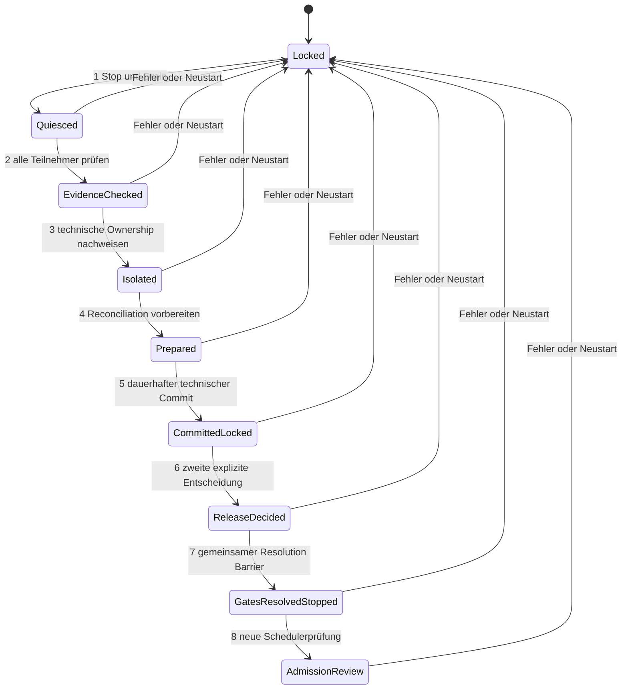

# Exklusives Aktor-Gateway und koordinierte Recovery

Architekturvorschlag für PR #101. Basis: `main` nach PR #100,
`f6ba66a`. Dieses Dokument unterscheidet bestehende Garantien und zukünftige
Anforderungen. Die neuen Verträge in `actuator_contract.py` sind nicht in Setup,
Services, Controller oder Scheduler integriert. Kein Gateway wird konstruiert.
Alle Ergebnisse behalten `native_activation_allowed=False`,
`hardware_exclusivity_proven=False` und `coordination_ready=False`.
Auch widerspruchsfreie Werte sind keine authentifizierten Nachweise.

## Bestehende Architektur und Steuerpfade

Grundlagen: [PumpController](native-pump-controller.md),
[Shots](native-shot-engine.md), [Cycle](native-cycle.md),
[Scheduler](native-scheduler.md), [Sicherheitsmigration](native-safety-migration.md),
[Snapshots](native-recovery-snapshots.md), [Ledger](native-recovery-ledger.md),
[Pläne](native-recovery-plans.md), [Transaktionen](native-recovery-transactions.md),
[Release-Design](native-recovery-release-design.md),
[Release-Implementierung](native-recovery-release-implementation.md),
[Review](native-recovery-release-review.md),
[Teilnehmergates](native-recovery-participant-gates.md),
[Revisionen](native-recovery-revisions.md) und
[Writer-Isolation](native-recovery-writer-isolation.md).

| Pfad | Wirkung und heutige Grenze |
| --- | --- |
| `pump.py`: `async_activate` → `_service` | Native ON/OFF an die Entity-Domain; lokaler Lock, Deadline, Ownership-Prüfung und Journal. Simulierte Ownership ist keine Produktionsfreigabe. |
| `pump.py`: `async_stop`, Deadline, Fehler, Unload, Restart-Reconciliation | OFF an gespeichertes Ziel; frischer HA-OFF-Report und offene Calls werden geprüft. Verspäteter Service löst erneute Reconciliation aus. Bereits versendete ON-Aufträge können nicht zurückgerufen werden. |
| `shot_engine.py`: Reservierung/Ausführung/Abbruch | Übergibt geprüfte Operation an PumpController; Journal, Accounting und Duplikatsperre. Keine Isolation fremder Writer. |
| `cycle.py` | Phasen-, Baseline- und Accountingentscheidung; beeinflusst Zulassung, kein direkter Pumpen-Service. Historische Teilbewässerung kann nicht durch Flag-Reset verschwinden. |
| `scheduler.py` | Timer/Evaluation → ShotCoordinator; Stop/Drain und Retry-Latch. Lokale Quieszenz ist kein globaler Command-Barrier. |
| `native_safety.py` | `OwnershipEvidence` akzeptiert hier nur simulierte Pumpe. Review-Booleans sind keine Gerätezugriffskontrolle. |
| `__init__.py`: bestehender `stop_pump`-Service → `_stop_pump_for_entry` | Direkter `homeassistant.turn_off` an konfigurierte Pumpe; eigener OFF-Pfad außerhalb des nativen Controllers. Bleibt unverändert. Andere Helper-Services ändern Phasen/Referenzen/Zähler, nicht direkt den Pumpenaktor. |
| Legacy-Blueprint `blueprints/automation/growassistant_crop_steering/shot_engine.yaml` | P1/P2/P3 verwenden `homeassistant.turn_on` und `turn_off`; umgehen den nativen Pumpenlock. Bereits laufende Automation und verzögerte Aktionen sind separat zu drainieren. |
| HA-Oberfläche, Entwicklerwerkzeuge, REST/WebSocket, Scripts und Automationen | `switch`/`homeassistant` ON/OFF/toggle, Entity-/Area-/Device-/Gruppenziele und indirekte Scripts können denselben Aktor erreichen. Kontext-ID ist kein Writer-Credential. |
| Externe Integrationen, MQTT, Hersteller-Cloud, lokale Geräte-API, andere HA-Instanz | Schreiben teilweise ohne verlässliches HA-Serviceevent; retained MQTT oder verzögerte Retries können nach OFF aktivieren. |
| Direkter Aktorzugriff | Taster, Zeitprogramm/Firmware, Stromwiederkehr, LAN/Funk, Wartungsanschluss, Relaiskontakt oder alternative Stromversorgung umgehen Software vollständig. |

Die letzte Gruppe ist installationsabhängig und aus Repository/HA nicht vollständig
inventarisierbar. Fehlende Beobachtung bedeutet unbekannte Abdeckung. HA-Schalter
in `switch.py` setzen GrowAssistant-Konfiguration; sie sind kein exklusiver
Pumpenausgang. Test-FakePump und Simulationsskripte beweisen nur Modellverhalten.

`recovery_revision.py` bestätigt seit PR #99 lokale abgeschlossene Writes im
bestehenden Journalumschlag, inklusive Journal-ID, Revision und Digest. Das ist
weder rollbackgeschützter Speicher noch ein Multi-Store-Commit. Accounting teilt
Shot-Provenienz; fehlende/Legacy-Revisionen werden nicht erfunden.
`recovery_writer.py` beobachtet seit PR #100 konflikthafte und unbekannte Writer;
`exclusive_isolation_confirmed` bleibt zwingend falsch. Die globale Generation
für einen zukünftigen Aktor darf nicht aus lokalen `OwnershipGeneration`-Zählern
abgeleitet werden. Diese sind laufzeitgebundene Diagnostik.
`recovery_participant.py` sammelt teilnehmereigene Belege; niemand löst Gates.
`recovery_transaction.py` persistiert diagnostische Beobachtungen, keine echten
Teilnehmer-Commits. `recovery_release.py` protokolliert explizite Ablehnungen;
auch ein technischer Commit ist keine positive Cycle-Freigabe.

## Bedrohungs- und Fehlermodell

Zu verhindern sind Split-Brain-Writer, Zielverwechslung, alter ON nach Übergabe,
ON nach OFF, Replay, doppelte Lieferung und Release aus partiellen Commits.
Crash, Timeout, verloren gegangene Antworten, späte Executor-IO, Diskfehler,
Lease-Ablauf, HA-/Gateway-Neustart und neue Fehler sind normale Fehlerfälle.
Unbekannte Lieferung bleibt unbekannt; alte Operationen bleiben verbraucht.
Ein Review belegt eine Entscheidung, nicht rückwirkend Wasserfluss oder Stromlosigkeit.

HA und zukünftiger Controller sind getrennte Vertrauensdomänen. Privilegierter
HA-Code kann Datenverträge fälschen; deshalb darf er nicht allein technische
Isolation bestätigen. Gateway-Authentifizierung, Geräteschlüssel, ACLs und
Hardwareverdrahtung brauchen unabhängige Prüfung. Kompromittierter Gateway oder
mechanisch klebendes Relais erfordern eine separate Abschaltkette. Physischer
Manipulationsschutz und dessen Annahmen müssen je Installation festgelegt werden.

## Gateway-Alternativen

| Modell | Technische Durchsetzung | Neustart/Netzverlust | Direkter Zugriff / Bewertung |
| --- | --- | --- | --- |
| HA-interne Abstraktion | Serialisiert nur kooperierende Aufrufer; HA-Lock sperrt keine anderen Services oder Geräteclients. | HA-Crash verliert Lease/Tasks; versendete Calls bleiben unterwegs. | Kein Schutz gegen Bypass. Als Adapter brauchbar, als Exklusivitätsnachweis unzulässig. |
| Exklusiv konfigurierter physischer Aktor | Ein Credential/Netzsegment, deaktivierte Cloud/Autostarts/Taster, Geräte-Watchdog und OFF bei Boot; nur ausreichend, wenn das Gerät diese Regeln tatsächlich erzwingt. | OFF-Watchdog muss ohne HA/Netz wirken; alte Befehle müssen am letzten Ausführungspunkt gefenced werden. | Konfiguration allein reicht nicht. Geräte ohne Fencing/Queue-Drain benötigen vorgeschalteten Controller oder Austausch. |
| Separater Gateway-/Controller-Prozess | Ein authentifizierter Writer je physischem Kanal, persistente Generation, Fencing und deduplizierte Ausführung am Aktor; Credentials nur dort. | HA-Ausfall lässt Lease verfallen; Controller bootet OFF und gesperrt mit neuer Boot-ID. Netzausfall löst lokalen Watchdog aus. | Empfohlen, sofern kein paralleler Gerätepfad existiert und die letzte Transportstrecke abgesichert ist. Ein separater Prozess allein genügt nicht. |

## Empfohlene Zielarchitektur

Ein separater Controller besitzt den einzigen technisch zugelassenen Zugang zum
identifizierten Aktorkanal. HA sendet nur Intents an diesen Controller. Der
ursprüngliche Aktor darf von HA, Legacy-Automationen, Hersteller-Cloud oder
anderen Clients nicht mehr schaltbar sein. Netzwerk-ACLs und exklusive Credentials
müssen Bypässe verhindern; bei nicht absicherbarem Geräteprotokoll ist ein anderer
Aktor oder eine verdrahtete Sicherheitssteuerung erforderlich. Ein HA-Proxy über
einen weiterhin öffentlich schaltbaren Switch erfüllt den Vertrag nicht.

Der Controller prüft Fencing **am letzten irreversiblen Ausführungspunkt**.
Ein MQTT/HTTP-Client, der nur vor dem Versand validiert, kann alte ON-Pakete im
Gerätenetz nicht neutralisieren. Dann muss das Gerät selbst Tokens prüfen oder
der Controller den physischen Ausgang besitzen. Nach Ownership-Wechsel werden
alte Queues verworfen; neue Lease erst nach OFF/Drain und sicherem Barrier.

OFF hat eine separate authentifizierte Sicherheitsroute mit höherer Priorität,
unabhängig von normaler Lease, Recovery-, Cycle-, Accounting- und Disk-Sperre.
Sie kann immer nur Energie reduzieren, niemals ON oder eine Freigabe erzeugen.
Bei OFF wird eine Stop-Generation vor allen späteren ON wirksam; gepufferte ON
werden verworfen. Bei Speicherfehler wird OFF versucht, aber kein neuer Writer
zugelassen. Ein lokaler Watchdog/Not-Aus muss bei gestörter Verbindung wirken.
Diese Route wird in diesem PR weder angeboten noch implementiert.

## Datenverträge und Validatorgrenze

Alle neuen Werte sind eingefrorene Dataclasses mit unveränderlichen Unterwerten.
Die existierenden `ResourceBinding`, `BootEpoch`, `OwnershipGeneration` und
`JournalReceipt` werden wiederverwendet. Keine Serialisierung, Credentials,
Aussteller, Persistenz, Gate-Mutatoren oder öffentliche API werden ergänzt.

| Vertrag | Bindung |
| --- | --- |
| `ActuatorIdentity` | ResourceBinding plus unveränderliche Hardware-ID, Kanal und Enforcement-Domäne; Entity-ID allein ist keine physische Identität. |
| `OwnershipEpoch` | Gateway-Boot-ID und monotone OwnershipGeneration; gleiche Generation aus anderem Boot ist ungleich. |
| `OwnershipLease` | Exakter Aktor, Epoche, einziger Writer, HA-Boot, Lease-ID sowie Anfang/Ende auf monotoner Gateway-Uhr. |
| `FencingToken` | Lease-ID, Epoche und Writer; zukünftig authentifiziert und manipulationsgeschützt, heute nur Wert. |
| `CommandIntent` | Exaktes Ziel, eindeutige Command-ID, ON/OFF, Token, HA-Boot, Sequenz und Deadline. |
| `CommandReceipt` | Vollständiger Intent, Gateway-Boot, Sequenz, Ergebnis und beobachteter Zustand samt monotoniem Beobachtungszeitpunkt. `accepted` heißt nicht physisch ausgeführt. |
| `IsolationEvidence` | Lease, Referenz auf technische Enforcement-Prüfung, abgedeckte Pfade und Prüfzeit; bestätigt hier niemals Isolation. |
| `ContractCheck` | Blocker für Konsistenzprüfung; selbst leere Blocker sind keine Autorität. Alle drei Autoritätsfelder sind konstant falsch. |

`validate_lease` prüft Ziel, Boot/Generation, Identität, endliche monotone Zeiten
und das halboffene Intervall `[issued, expires)`. `validate_command` prüft zusätzlich
Token, Reihenfolge und Deadline innerhalb der Lease. Normaler OFF unterliegt
diesem Vertrag; ein Fehler darf den separaten Sicherheits-OFF nicht verhindern.
`validate_receipt` prüft genaue Zuordnung, Resultat, Aktualität und unbekannte
Zustände. Ein abweichender/negativer Receipt darf nie als Ausführungsbeleg gelten.
`validate_gate_contract` erhält tatsächliche ParticipantAggregation und
JournalReceipt-Mengen, prüft Sammlung und Revisionskonflikte und vereinigt
bestehende Blocker. Es schafft keine neue Entscheidungsautorität. Die Validatoren
sind interne typisierte Funktionen, keine Parser für untrusted Netzwerkdaten.

## Ownership-Leases und Fencing

Eine zukünftige Authority muss Generationen dauerhaft und atomar pro physischem
Aktor vergeben, vor Ausgabe persistieren und genau einen Writer reservieren.
Jede neue Lease/Übergabe erhält eine höhere Generation; keine Wiederverwendung,
kein Überlauf und kein stilles Zurücksetzen nach Snapshot-Restore. Gateway-Boot-ID
wird bei jedem Restart neu erzeugt, alle alten Leases werden ungültig. Verlust
oder Rollback der Generation sperrt Admission bis zu unabhängig abgesichertem
Re-Provisioning. Ein neuer Bootname alleine löst einen persistierenden alten
Controller im Split Brain nicht: Single-Leader-Enforcement am Aktor ist nötig.

Prüfung bei Annahme, Queue-Entnahme und unmittelbar vor physischer Ausführung:
aktuelle Lease, identischer Writer/Boot/Aktor, gültiges Token, Sequenz und
nicht abgelaufene Deadline. Erneuerung ist authentifiziert und kann keine alte
Generation wiederbeleben. HA-Uhren und UTC dürfen keine Lease verlängern.
Ticks sind nur innerhalb derselben Gateway-Boot-Uhr vergleichbar. Ein alter
Writer kann seine numerische Generation nicht selbst erhöhen; Wertevergleich
ersetzt nicht die authentifizierte Authority.

Deduplication: `(Aktor, Epoche, Command-ID)` bindet unveränderlich den kompletten
Intent. Identischer Retry gibt nur den gespeicherten Receipt zurück; anderer
Inhalt unter derselben ID wird verworfen. Eine Sequenz verhindert Umordnung.
Dauerhaftes Intent-vor-Ausführung-Logging garantiert bei Crash nicht exakt einmal
Wasserlieferung: unbekanntes Ergebnis wird gesperrt und nicht automatisch replayed.
Verspätetes OFF bleibt sicherheitswirksam, darf aber keine neue Epoche freigeben;
es invalidiert aktuelle Arbeit und verlangt neue Reconciliation.

## Physische OFF-Evidenz

HA-Zustand `off`, erfolgreicher Servicecall oder `software_off`-Receipt beweisen
keinen stromlosen Ausgang. Ein zukünftiger physischer Beleg benötigt unabhängige
Messquelle/Feedbackkontakt, geprüfte Kanalzuordnung, Quelle/Boot, Messsequenz,
Erfassungszeit, begrenzte Lebensdauer, Qualität/Kalibrierung und Bindung an den
letzten OFF-/Stop-Barrier sowie Ownership-/Sicherheitsgeneration. Er muss nach
dem letzten möglicherweise wirksamen ON und nach Queue-Drain erhoben werden.

Auch Stromlosigkeit beweist keinen Wasserstillstand: Siphon, Restdruck und
Nachlauf erfordern hydraulische Drain-/Tray- und gegebenenfalls Flussbeobachtung.
Der genaue Sensoraufbau und Grenzwerte sind offener installationsbezogener
Sicherheitsnachweis. Fehlendes, restauriertes, widersprüchliches oder nicht
frisches Feedback hält alle Gates geschlossen. Dieser PR erzeugt keinen
positiven physischen Beleg aus Softwaredaten.

## Zustandsautomat und Recovery-Gate-Koordination

Dies ist eine Spezifikation für kommende PRs, kein laufender Automat. Jeder
Zustand bis zur späteren separaten Admission bleibt für Bewässerung gesperrt.

1. **Quiesce:** Scheduler-Admission schließen und Generation erhöhen, Timer,
   Evaluations-, Shot-, Service-, Accounting- und Executor-Arbeit vollständig
   drainieren. Pumpen-OFF priorisieren, Drain/Tray prüfen. Unauflösbare alte Calls
   sind Blocker, keine Erlaubnis zum Weitergehen. Stop braucht keine Recovery-Sperre.
2. **Nachweisprüfung:** tatsächliche Pump-, Shot-, Accounting-, Cycle- und
   Schedulerbelege für genau einen Request samt Boot, Runtime-Epochen,
   Sicherheitsgeneration, Operationsumfang und Journal-/Ledgerrevisionen prüfen.
   Kein ausgewählter Teilumfang. Historische Fehler und unbekannte Menge bleiben.
3. **Exklusive Ownership:** nachgewiesene externe Pfadabschaltung und technische
   Enforcement-Prüfung; frische Lease/Epoche und OFF-Beleg nach Queue-Barrier.
   Ownership-Wechsel invalidiert frühere OFF-/Teilnehmerbelege: erneut erfassen.
4. **Prepare:** Teilnehmer erstellen eigene idempotente Dispositions-/Reconciliation-
   Vorschläge mit erwarteten und resultierenden Revisionen. Accounting prüft
   Provenienz über Stores/Optionen, Cycle entscheidet agronomische Folgen,
   Wasserbudget, Warteentscheidung und explizite neue Baseline. Kein `permits()`
   als mutierender Prüfersatz. Noch keine Gate-Auflösung.
5. **Persistenter Commit:** Recovery-Ledger bindet Fall, Reviews, Plan-Digest,
   vollständige Teilnehmerliste, Generationen und Prepare-Receipts an einen Intent.
   Teilnehmer bestätigen eigene revisionierte Commits. Erst nach allen validierten
   Rückmeldungen folgt ein technischer Commit über genau diese Menge. Hashketten
   ersetzen keine Signatur, Rollbackabwehr oder Multi-Store-Atomizität.
6. **Zweite explizite Release-Entscheidung:** neuer authentifizierter Entscheidungsakt,
   getrennt vom Review und Commit; exakte Commit-/Plan-/Cycle-/Revisionsbindung,
   Begründung und frische vollständige Nachweise. Ablehnung bleibt gesperrt.
   Aktuelles `recovery_release.py` kann weiterhin ausschließlich ablehnen.
7. **Koordinierte Gate-Auflösung:** zukünftiger gemeinsamer Admission-Barrier bleibt
   geschlossen, während jeder Teilnehmer nur sein eigenes Gate vorbereitet und
   quittiert. Niemand darf aus lokaler Quittung Zulassung ableiten. Erst nach allen
   Auflösungsquittungen und synchroner Prüfung nach dem letzten await kann ein
   flüchtiger gemeinsamer Resolution-Nachweis veröffentlicht werden. Jeder Consumer
   verlangt diesen Nachweis zusätzlich zum lokalen Gate. Bei Teilfehler wird die
   gemeinsame Generation sofort widerrufen; lokale Teilfortschritte sind keine
   Autorität. Kein zentraler Schreibzugriff auf private Flags.
8. **Spätere Scheduler-Zulassung:** gesonderte aktuelle Sensor-, Drain-, Tray-,
   Budget-, Zeitfenster-, Baseline-, Ownership- und Generationenprüfung. Gate-Auflösung
   startet nichts. Keine Ersatzbewässerung und kein automatisches Replay.

Lock-Reihenfolge bleibt Recovery → Cycle → Accounting; Stop/Revocation wartet
nicht darauf. Keine Netzwerk-/Storage-Operation hält einen Pumpen-Stop-Lock fest.
Widerruf erhöht synchron die Sicherheits-/Admissiongeneration. Prüfung nach dem
letzten await und bei jeder späteren Nutzung verhindert stale Freigaben.
Restart lädt nur Historie, nie Permit oder laufzeitgültige Bestätigung. Ein
unvollständiger Commit wird diagnostiziert und neu explizit bearbeitet, niemals
automatisch finalisiert. Alle Crash-Präfixe booten gesperrt.

## Crash- und Failure-Matrix

Für jede Zeile gilt: aktuelle Freigabe wird verworfen, keine Ersatzshots. OFF wird
über unabhängigen Sicherheitspfad versucht; bei unbekanntem Ergebnis bleibt die
physische Sicherheit unbewiesen. „Neu prüfen“ bedeutet den vollständigen oben
beschriebenen Ablauf inklusive zweiter Entscheidung, keinen lokalen Reset.

| Fehler | Erkennende Instanz | Bestehende Sperre / spätere notwendige Evidenz |
| --- | --- | --- |
| HA-Neustart | neue HA-Boot-Epoche, Gateway-Lease-Watchdog | keine Permit-Restauration; neue Lease, Drain, Teilnehmer-/Journal-/Ledgerprüfung und physisches OFF |
| Gateway-Neustart | neue Gateway-Boot-ID, Controller-Boot-Interlock | Ausgang OFF/Admission geschlossen; alte Tokens ungültig, Generation dauerhaft fortführen und unabhängige OFF-Prüfung |
| Netzwerkunterbrechung | Gateway-Watchdog, HA-Timeout | Lease verfällt; lokaler OFF, unbekannte Calls gesperrt; Verbindung, Queue-Drain und frische Messung nachweisen |
| Verspäteter ON | Aktor-Enforcer prüft Token/Deadline/Stop-Generation bei Ausführung | ablehnen; fehlt diese Kontrolle ist Architektur ungeeignet; Drain-/Ablehnungsreceipt und neues OFF nötig |
| Verspäteter OFF | Gateway-Sequenz/Deduplog, Teilnehmerbeobachtung | OFF darf wirken, aktuelle Operation wird unsicher; keine neue Freigabe aus altem Receipt, neue Reconciliation |
| Ownership-Wechsel | persistente Authority + Aktor-Enforcer | höhere Generation invalidiert alten Writer; frische Lease, alle Belege neu binden |
| Abgelaufene Lease | monotone Gateway-Uhr/Watchdog | ON abweisen, OFF unabhängig; neue authentifizierte Lease nach Stop-Barrier |
| Falsches Fencing-Token | authentifizierter Gateway-/Aktor-Prüfer | ablehnen, Konflikt auditieren und Admission sperren; korrekter Authority- und Isolationsnachweis |
| Doppelte Befehle | dauerhafter Gateway-Deduplog | identischer Retry nur Receipt, abweichender Inhalt Konflikt; Log und unbekannte Ausführungspräfixe prüfen |
| Unbekannter physischer Zustand | unabhängiges Feedback, Pump-/Sensorprüfung | OFF-Softwarestatus genügt nicht; frischer unabhängiger Kanal-/Hydrauliknachweis |
| Speicherfehler/Timeout/später Write | JournalRevision, Ledger, Gateway-Storage | Ungewissheit bleibt sticky; keine neue Lease/Commit-Freigabe, OFF unabhängig; Integrität, Abschluss, Rollbackschutz und Revisionen neu prüfen |
| Partielle Teilnehmer-Commits | Coordinator vergleicht vollständige Receipt-Menge | gemeinsamer Admission-Barrier bleibt zu; fehlende/widersprüchliche Revisionen explizit reconciliieren, kein automatisches Commit-Finish |
| Neuer Fehler während Recovery | Teilnehmer, Sensor-/Writerbeobachter, Generationguard | synchroner Widerruf aller Versuchsbelege; Ursache, neuer Plan und neue vollständige Nachweise |
| Legacy-Automation greift direkt zu | HA-Beobachter nur best effort; entscheidend ist Aktor-ACL | Zugriff technisch verweigern; bei wirksamem Bypass Isolation ungültig und System sperren; Credentials/Pfade entziehen, alte Jobs/Queues drainieren und Enforcement erneut prüfen |

Ein nicht sichtbarer Legacy-/Gerätezugriff wird von HA möglicherweise **nicht**
erkannt. Darum ist beobachtete Ruhe niemals ein positiver Isolationstest.

## Migration und kommende Implementierungsphasen

1. **Dieser PR:** Schreibpfadinventar, Bedrohungsmodell, immutable Verträge,
   reine negative/strukturelle Validatoren und Crash-Vertragsbeispiele. Keine
   produktiven Imports, Journaländerungen, Gate-Mutatoren oder öffentliche Services.
2. **Enforcement-Prototyp außerhalb Produktion:** Aktor auswählen, physische
   Identität und alle Zugriffswege prüfen; Controller-/Aktor-Fencing, Watchdog,
   Boot-OFF, monotone persistente Generation und Netzpartition/Split Brain testen.
   Fehlt technische Durchsetzung, hier stoppen; keine HA-interne Scheinlösung.
3. **Authentifizierter Gateway-Vertrag im isolierten Harness:** Authority,
   deduplizierte Intents/Receipts, Prioritäts-OFF und Hardware-Feedbackmodell;
   Fault-Injection am letzten Ausführungspunkt und an jeder Persistenzgrenze.
   Testmodelle kennzeichnen; kein produktives Gateway aktivieren.
4. **Teilnehmereigene Prepare-/Commit-Verträge:** vollständige Accounting- und
   Cycle-Disposition, Baseline, Scheduler-Quiesce-/Admissiongeneration und
   revisionierte Quittungen. Unveränderte historische Delivery-Daten nachweisen.
5. **Koordinierter Resolution-Barrier und zweite Release-Entscheidung:** vollständige
   Crash-Präfix-/Konkurrenztests, synchroner Widerruf und Consumer-Prüfungen;
   gespeicherte Historie darf niemals aktive Autorität rekonstruieren.
6. **Separater Hardware-/Installationsreview vor Aktivierung:** Legacy-Automationen
   stoppen und deaktivieren, direkte Zugangsdaten entziehen, Cloud-/MQTT-/Taster-
   und Bootpfade testen, physische OFF-Messung qualifizieren, Rückfall ausschließlich
   in sicheren gesperrten Zustand. Keine parallele native/Legacy-Migration.
7. **Eigenständiger Aktivierungs-PR:** erst mit vollständigen Sicherheitsnachweisen
   über produktive Integration und separate Scheduler-Admission entscheiden.

Offen bleiben insbesondere: nachweisbare Single-Leader-Durchsetzung am letzten
Schaltpunkt, persistenter Anti-Rollback-Schutz, Hardwareausfall/Relaiskleben,
Watchdog-Grenzzeiten, sichere Wartung/Not-Aus, Authentifizierung und Schlüsselrotation,
unabhängige OFF-/Fluss-/Drain-Evidenz, stromausfallsichere Commit-Persistenz,
Cross-Store-Accounting, agronomische Baseline-Disposition und atomare gemeinsame
Admission bei partieller lokaler Gate-Auflösung. Keine dieser Lücken wird durch
einen positiven Datenvergleich geschlossen.

## Validierung

Ergebnisse werden nach Abschluss der lokalen Suite und GitHub-Prüfungen ergänzt.
Die Vertragstests prüfen Konsistenz und sichere Ablehnung; sie sind keine Tests
eines realen Gateways, der physischen Exklusivität oder positiver Recovery.
