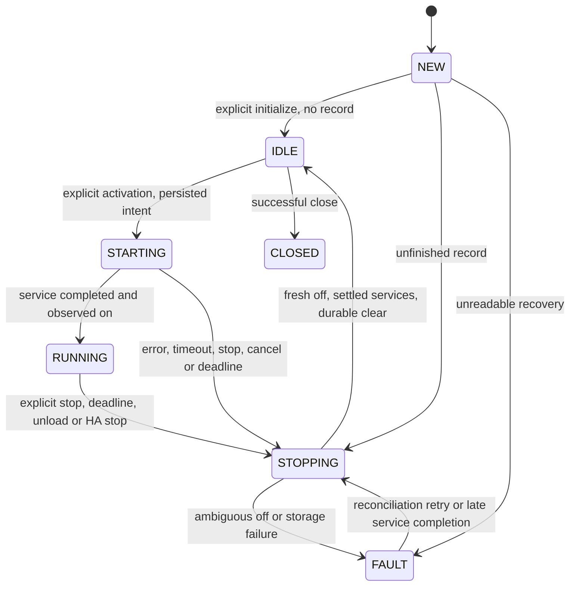

# Native pump controller: phase 1

## Scope and architecture verification

Based on main `a70caba4141f2dd1b6d5790089231e721908f9b9`, including merged PR #67.
The unmodified baseline was reproduced: 105 passed (94 logic/Blueprint tests,
11 real HA lifecycle tests), Python 3.13.16 and HA 2025.12.5.

The repository's lifecycle findings remain applicable: `_CycleResetCoordinator`
maintains a durable cycle marker and subscribes to helper/time events. Four
platforms expose managed entities with stable unique IDs. Options are read live
but helper subscription changes require explicit reload. Domain services survive
entry unload; HA retains entity/device registry records. Steering sensors compute
P0/P1/P2/P3 readiness; the Blueprint owns actual pump activation, shot duration,
counters, timestamps and a parallel delayed off failsafe. Python's legacy
`stop_pump` service directly dispatches off to the current selector.

No separate previous architecture report was available in the supplied checkout
or chat; verification used source, README, Blueprint, and the lifecycle findings
in `tests/lifecycle/README.md` rather than assuming unseen conclusions.

Production setup never constructs or initializes `PumpController`. No new service,
configuration option, scheduler or automatic shot path exists. The only lifecycle
change checks for an explicitly initialized native owner before unload. Without
one, it is a no-op. The Blueprint and every existing service, selector, entity ID,
unique ID, counter and timestamp remain unchanged. Native and Blueprint pump
ownership must be made mutually exclusive before native execution is enabled.

## API (internal development primitive)

`PumpController(hass, entry)` constructs an inactive object. Call these async
methods only from HA's event loop:

| API | Behavior |
| --- | --- |
| `async_initialize()` | Explicitly claim the sole native owner in this HA instance, load Store, install HA stop listener, and reconcile any unfinished recorded pump. Never dispatch on. Repeated initialization/another owner raises `PumpError`. |
| `async_activate(runtime)` | Validate finite runtime in `(0, 300]` seconds, resolve `pump_switch` from options then data, snapshot entity, require observed off and available on/off services, durably record intent before dispatch, and return operation ID after observed on. Reject while busy, faulted, closing or cancellation cleanup is pending. |
| `async_stop()` | Coalesce concurrent stop requests; return `True` only after a fresh observed off report, no ambiguous service in flight, and durable recovery clear. `False` retains a fault and recovery target. Retry is reconciliation, never shot replay. |
| `async_close()` | Immediately block further starts, finish stop despite caller cancellation, then release owner and HA listener only on success. Used by integration unload and HA stop event. Failed unload returns false before unloading platforms. |
| `state`, `fault` | Inspect status and shutdown/load error text. Faults cannot be bypassed by activating. |
| `recovery_record` | Independent snapshot of entity, operation ID, activation-intent UTC timestamp, maximum allowed UTC deadline and operation state. Changing it cannot retarget the pump. |

`HARD_MAX_RUNTIME = 300` is a fixed cap, not a migrated setting. Service,
confirmation and storage waits default to five seconds each. Runtime starts before
intent persistence and uses the event loop's monotonic clock; UTC is used only
for the durable audit/deadline. The timer requests off at the deadline and
activation/persistence waits cannot extend the requested runtime. A requested
limit is not a promise that physical power is removed at that exact instant.

## State transitions

A closing controller cannot reactivate even if reconciliation reaches idle.
An activation validation failure leaves idle without dispatching on. A failed
recovery load never becomes idle merely because stop has no known entity.
Malformed records remain untouched and block activation for manual repair.

## Persistence, races and cancellation

Store key: `growassistant_crop_steering.pump_recovery.<entry_id>`, version 1,
separate from cycle-reset storage. Intent is saved before on; running/fault
snapshots follow. Stopping is also an in-memory state; the original unfinished
record remains sufficient if power is lost during shutdown. Successful completion
writes a null record. No recorded operation is replayed on initialization.

A successful HA service return alone never clears recovery. Off confirmation
requires a report newer than the pre-off snapshot (new State object or advanced
`last_reported`). A pre-existing off state is insufficient. State changes wake
confirmation immediately; unchanged off reports are checked asynchronously too.
Unavailable, unknown and missing states cannot confirm shutdown.

Timed-out services are not cancelled: cancellation cannot undo a delivered device
command. They remain tracked. Shutdown attempts off immediately, but an earlier
unsettled call latches ambiguity for that attempt, even if it completes during
confirmation. Late completion of a timed-out call triggers another off
reconciliation for the same operation ID. It cannot stop a subsequent operation.
Failed close retains ownership so another controller cannot lose live-call
tracking. There is no automatic activation or retry of a shot.

Control transactions share a lock. Stop requests latch before waiting for the
lock; activation checks that latch before service dispatch. Concurrent stop callers
share one safety task. Shielding protects safety work against repeated caller
cancellation; cancellation is propagated after cleanup completes or records a
fault. Close disables starts before waiting. Service self-cancellation is treated
as ambiguous delivery and reconciled. Storage waits are bounded, failures block
activation or preserve a fault, and off attempts precede shutdown storage work.
Timed-out writes remain tracked without cancellation: no newer snapshot or clear
is dispatched while an older disk write is unresolved, so a late old write
cannot overwrite the recovery record for a subsequent activation.

## Safety boundaries and remaining work

Software tests cannot prove physical pump shutdown. HA states may be optimistic,
stale or false; an `input_boolean` is only a helper. Relay welding, device/network
failures, downstream queued commands, event-loop starvation, kill/power loss,
disk loss/corruption and OS/executor cancellation behavior are not solved by
shielding or Store. Store success is HA's persistence guarantee, not a verified
power-loss/fsync guarantee. A hung service can remain live after the controller
reports a fault; it cannot be forcibly made safe. Native ownership covers this
process only, not other automations, HA processes or external device controllers.
Use an independent hardware cutoff/watchdog and trustworthy feedback before
claiming a physical hard runtime limit. All testing uses synthetic entities and
fixture storage, with network sockets blocked by the HA test plugin.

Phase 2 must design an explicit enable/ownership transition, initialize recovery
at the correct HA startup point, surface faults and reconciliation controls, and
coordinate selector changes and unload failure UX. Native shot scheduling then
needs monotonic shot timing, phase/readiness/soak policies, daily limits,
exactly-once counter/timestamp updates, missed-shot policy and durable operation
coordination. It must never replay interrupted shots, and must retire Blueprint
execution only after mutually exclusive ownership and migration are validated.
No counter/timestamp migration or scheduling changes belong to this phase.

## Validation

- Original main: **105 passed**, before source changes.
- Complete suite: **158 passed** (105 baseline + 51 pump safety + 2 native HA lifecycle tests), no skips/xfails.
- Dedicated pump suite: **51 passed**.
- Ruff lint: passed. Ruff formatting: 24 Python files formatted, passed.
- Python compilation and Git whitespace checks: passed.
- The native lifecycle timeout test restores real monotonic loop time explicitly:
  the HA fixture overrides the frozen-time plugin's loop clock. Synthetic cycle
  time remains frozen; real timer behavior is required for timeout assertions.
- The pre-existing fixture/HA metadata exception remains unchanged:
  fixture 0.13.301 pins HA 2025.12.4, while CI uses tested HA 2025.12.5.
- Remote Actions results are reported on the draft PR; local results are not a
  substitute for HACS/hassfest or hosted CI.
