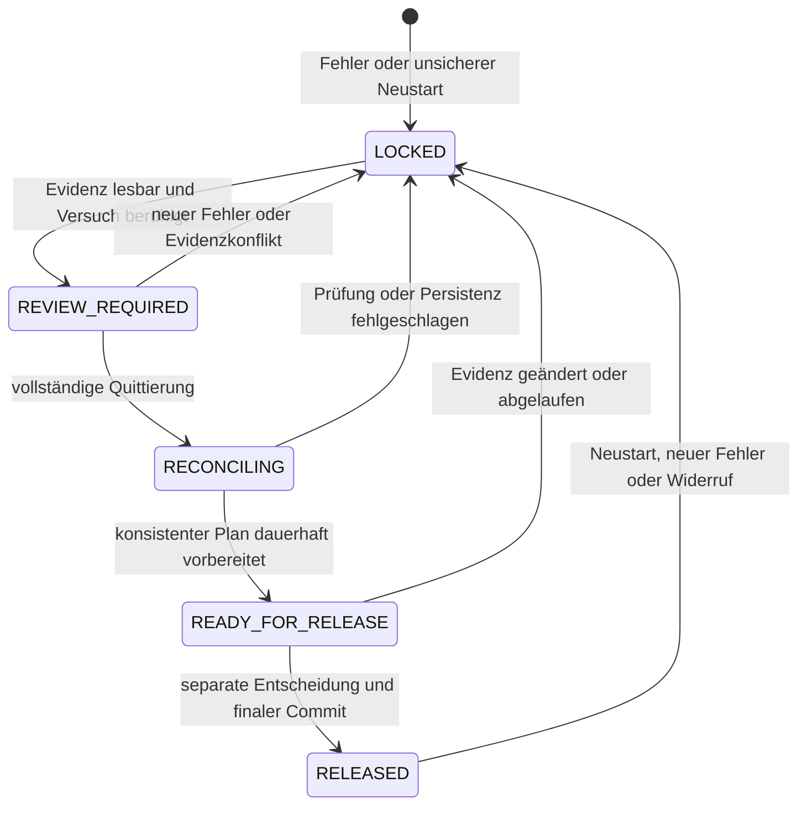

# Native Recovery und kontrollierte manuelle Wiederfreigabe

Status: Architekturvorschlag, keine implementierte Recovery-Schnittstelle.
Basis: `main` nach PR #91, Commit
`0c23f2fb215bdb50e8e90f7d6ce074fda2c072a9`.
Der [Recovery-Review](native-recovery-release-review.md) dokumentiert die
bestehenden Sperren und 841 bestandene Tests. Diese Zahl ist dessen Befund,
kein neuer Testlauf dieses Dokumentations-PRs.

## Sicherheitsinventur nach PR #107
Der aktuelle anforderungsbezogene Stand steht im
[Native-Recovery-Sicherheitsaudit](native-recovery-safety-audit.md), mit
[Coverage-Matrix](native-recovery-safety-coverage.md) und
[priorisiertem Gap-Backlog](native-recovery-gap-backlog.md).
Designziele oder positive Fake-Protokollfälle sind keine Produktivnachweise;
die bestehenden Aktivierungs- und Release-Sperren bleiben unverändert.

## 1. Zweck, Begriffe und Grenzen

Das Verfahren soll einen konkreten Fehler nachvollziehbar bearbeiten und einen
definierten Bewässerungszyklus gegebenenfalls wieder freigeben können. Es darf
weder einen alten Shot wiederholen noch eine reale Pumpe aktivieren.
Alle folgenden neuen Zustände, Datensätze und Methoden sind Vorschläge für
spätere, separat geprüfte Implementierungen. Dieser PR ändert ausschließlich
Dokumentation; produktive Logik, Services, Buttons, Tests, bestehende Gates,
persistierte Laufzeitjournale und `native_activation_allowed` bleiben unverändert.

Vier Entscheidungen bleiben getrennt:

| Entscheidung | Bedeutung | Bewirkt ausdrücklich keine |
| --- | --- | --- |
| Fehlerquittierung | Authentifizierter Bediener hat eine konkrete Operation und ihre Folgen geprüft. | Reconciliation, Cycle-Freigabe oder Aktivierung |
| Reconciliation | Technische Evidenz und fachliche Disposition ergeben einen konsistenten, dauerhaft gespeicherten Zustand. | Freigabeentscheidung oder Pumpenstart |
| Cycle-Wiederfreigabe | Explizite zweite Entscheidung akzeptiert genau einen geprüften Cycle-Plan unter aktuellen Bedingungen. | Wiederholung, Ersatzshot, Scheduler-Start oder produktive Aktivierung |
| Produktive Aktivierung | Künftige, eigenständige Sicherheitsentscheidung für reale Aktoren und Betrieb. | Implizite Erteilung durch einen Recovery-Abschluss |

`native_activation_allowed` bleibt in allen Recovery-Zuständen `False`.
Auch `RELEASED` ist keine Ausnahme. `execution_available` beschreibt heute nur
interne Harness-Bereitschaft und darf nicht als Produktionsfreigabe dienen.
Die normale Integration konstruiert/startet die Entwicklungskomponenten nicht.
Dieser Entwurf schafft dafür keinen neuen Einstieg.

## 2. Vorhandene Architektur und Wiederverwendung

Die unten genannten Dateien liegen unter
`custom_components/growassistant_crop_steering/`.

| Baustein | Wiederverwendbare Funktion und Evidenz | Grenze und erforderliche Ergänzung |
| --- | --- | --- |
| `pump.py`, `PumpController` | `async_initialize()` lädt das persistierte Ziel; `async_stop()` serialisiert OFF/Reconciliation. Bei vorhandenem Recovery-Record verlangt `_stop_locked()` einen frischen OFF-Bericht und dauerhaftes Journal-Clear. Verspätete Serviceabschlüsse veranlassen erneutes OFF. | `restart_had_recovery` bleibt gesperrt. `IDLE`, leeres Journal und der Rückgabewert von `async_stop()` ohne Record sind allein kein frischer OFF-Nachweis. Neuer unveränderlicher Safety-Snapshot muss offene Services, Late-Completion-Arbeit, Stop-/Activation-Tasks und Storage-Writes sowie die OFF-Evidenz ausweisen. |
| `shot_engine.py`, `_ShotCoordinator` | `async_initialize()` hält nichtterminale/pending Operationen als unterbrochen fest. `async_execute()` reserviert Identität, verhindert Duplikate und revalidiert; `_finish()` trennt Shutdown, Unsicherheit und Accounting-Intent. `_save()` toleriert keine überlappenden ungeklärten Writes. | `_blocked`, `pump_restart_requires_review` und `recovery_required` haben keine unterstützte Quittierung. Neue versionierte Review-/Disposition-Sicht erforderlich; alte Records nicht löschen, zu Erfolg umetikettieren oder private Flags von außen setzen. |
| Shot-Journal | `operations`, `accounting_pending`, `accounted`, `last_accounting`, `native_counters`, Recovery-/Reset-Marker liefern Rekonstruktionsdaten. `delivery_assessment` trennt erfolgreiche Shots von unsicheren Versuchen; Volumen bleibt unbekannt. | Keine atomare Transaktion mit Optionen und Cycle-Store. Neues Recovery-Ledger mit unveränderlicher Operationsreferenz, Revisionen und explizitem Commit-Protokoll erforderlich. |
| `cycle.py`, `_NativeCycleController` | `permits()` prüft Cycle-ID, Flags, Schedule, Zähler, Pending und P2-Referenz. `_commit()` nutzt persistierten Intent vor Optionsänderung; `async_initialize()` blockiert auch konsistente Restarts. Sunrise führt keinen Catch-up aus. | `async_manual_start/complete()` sind Phasenoperationen, keine Recovery. Neue Planvalidierung muss Phase, `p1_active`, `p1_done`, Tagesflag, P2-Referenz und verpasste Cycle-Grenzen zusammen prüfen. |
| `scheduler.py`, `_NativeScheduler` | Generationen und Timer-Verwerfung verhindern alte Evaluationen; `retry_blocked` bleibt bei Stop/Start erhalten. | Neue explizite Quiesce-/Drain- und Release-Schnittstelle erforderlich. Keine Freigabe über Stop/Start oder gesunde Sensorberichte; historische Trigger nicht nachholen. |
| `native_safety.py` | `assess_sensors()` prüft Alter, Quorum, Wertebereich, restaurierte Werte und Streuung. `assess_recovery()` aggregiert Gründe; `migration_eligibility()` ist eine reine Checkliste. | Assessments bleiben lesend und verbieten Aktivierung. Eine spätere Recovery-Sicht muss historische Fehler von offenem Review unterscheiden, ohne historische Evidenz auszublenden. Keine Ersetzung durch ein einzelnes `acknowledged=True`. |
| Ownership | `OwnershipEvidence.reasons()` bindet an exaktes Pumpenziel, Legacy-Abgabe, geprüfte Writer, Exklusivität und simulierte Pumpe. Controller und Coordinator prüfen beide. Lokale Owner-Registries verhindern doppelte interne Instanzen. | Keine Kontrolle beliebiger HA-/externer Writer. Ownership wird nach Restart nicht vertraut. Künftige Freigabe braucht frische, widerrufbare Ownership-Epoche; produktive Exklusivität ist weiterhin ungelöst. |

Die existierenden Stores heißen jeweils
`growassistant_crop_steering.pump_recovery.<entry_id>`,
`growassistant_crop_steering.shot_journal.<entry_id>` und
`growassistant_crop_steering.native_cycle.<entry_id>`.
HA-Entry-Optionen sind ein weiterer persistenter Teilnehmer. Ein erfolgreicher
einzelner `Store.async_save()` ist keine gemeinsame Transaktion dieser Daten.
Timeout oder Cancellation beweisen nicht, dass eine ausgelagerte Schreiboperation
oder ein Pumpenbefehl beendet wurde.

## 3. Sicherheitsinvarianten

1. Jeder unbekannte, veraltete, widersprüchliche oder nicht dauerhaft gespeicherte
   Nachweis blockiert. Ein Speicherfehler kann keine Freigabe erzeugen.
2. OFF, fehlerfreie Sensoren, Quittierung und Ownership sind jeweils notwendig,
   aber einzeln nicht hinreichend. Kein allgemeiner Clear-/Reset-Pfad.
3. Eine Operations-ID bleibt für immer verbraucht. Recovery erzeugt weder Shot
   noch Ersatzshot und schreibt keinen unterbrochenen Versuch als Erfolg um.
4. Erfolgszähler werden ausschließlich aus eindeutig belegten erfolgreichen
   Operationen und ihrem Cycle-Checkpoint abgeleitet. Jede Buchung hat einen
   eindeutigen Operationsschlüssel; eine unklare Buchung bleibt gesperrt.
5. Mögliche Teilbewässerung bleibt als historische Tatsache sichtbar. Ungeklärte
   Auswirkungen erlauben keine Wiederfreigabe des betroffenen Cycles.
6. Freigabe gilt nur für Entry, unverändertes physisches/virtuelles Pumpenziel,
   Cycle, Fehlerumfang, Journalrevisionen, Konfiguration und Laufzeitepoche.
7. Jeder neue Fehler und jede Änderung der gebundenen Evidenz widerruft laufende
   Freigabeversuche. Neustart stellt keine ausführbare Freigabe wieder her.
8. Die Recovery besitzt niemals die Befugnis zur produktiven Aktivierung.

## 4. Recovery-Zustandsmaschine

Ein Fall umfasst einen konkreten Fehler und die vollständige Menge betroffener
Operationen eines Entries/Pumpenziels. Mehrere offene Fälle bilden gemeinsam
eine Sperre: Freigabe eines Falls übergeht keinen anderen Fall.

Fehlererkennung ist ein Ereignis, kein abwartender Zustand: Ausführung sofort
sperren, Scheduler-Generation invalidieren und den bestehenden sicheren Stop-Pfad
anstoßen. Speicherung darf die Abschaltung nicht verzögern. Alle Zustände außer
einem laufzeitgebundenen `RELEASED` halten die Recovery-Ausführungssperre.

| Übergang | Voraussetzungen und zulässige Aktionen | Dauerhafte Änderung | Fehler / Abbruch / Neustart |
| --- | --- | --- | --- |
| Beliebig → `LOCKED` | Fehler, Ownership-Verlust, Journaldefekt oder unsicherer Restart. Nur Stop, Diagnose und Evidenzsammlung; keine ON-Aktion. | Fall mit Gründen/Operationen anlegen oder neue Revision und Widerruf anhängen; Freigabeepoche ungültig. | Sperre vor jedem await setzen. Bei Schreibfehler im Speicher gesperrt bleiben; beim nächsten Start fehlende/defekte Evidenz ebenfalls blockieren. |
| `LOCKED` → `REVIEW_REQUIRED` | Ziel/Operation eindeutig, Journale lesbar, Shot/Scheduler quiesziert. OFF darf noch fehlen; dies bleibt sichtbarer Blocker. Diagnose und Bedienerprüfung erlaubt. | Evidenzreferenzen, offene Pflichtprüfungen und Fallrevision speichern. | Fehlende Quieszenz oder defekte Identität: `LOCKED`. Neustart: Fall bleibt erhalten, effektiver Zustand `LOCKED`; Evidenz neu erfassen. |
| `REVIEW_REQUIRED` → `RECONCILING` | Vollständige authentifizierte Quittierung pro Operation einschließlich Teilbewässerung, OFF-Nachweis und Journalprüfung. Request bindet erwartete Revision. | Unveränderliche Quittierung und Reconciliation-Intent mit Plan-ID speichern; noch keine Gates öffnen. | Unvollständige Eingabe wird ohne Zustandswechsel abgewiesen. Konflikt/neuer Fehler: `LOCKED`. Crash: Intent bleibt gesperrt, keine automatische Fortsetzung zur Freigabe. |
| `RECONCILING` → `READY_FOR_RELEASE` | Alle Invarianten und Prüfungen aus Abschnitt 7; Teilnehmer bestätigen denselben vorbereiteten Plan. Nur Diagnose und Vorbereitung. | Plan, Dispositionen, Accounting-/Cycle-Prüfergebnis, Teilnehmerrevisionen und Ablaufbedingungen dauerhaft speichern. | Jede fehlende Bestätigung: `LOCKED` mit verbleibendem Intent. Neustart: Vorbereitung nur historisch, neue Prüfung erforderlich. |
| `READY_FOR_RELEASE` → `RELEASED` | Zweite ausdrückliche Entscheidung für genau diesen Plan; vollständige Live-Revalidierung unter Serialisierung, keine offenen Fälle/Tasks/Writes. | Release-Intent, Teilnehmerbelege, finaler Commit und Bedienerentscheidung; danach ausschließlich laufzeitgebundene Recovery-Berechtigung veröffentlichen. | Konflikt, Timeout, Cancellation oder Prüfungsänderung: `LOCKED`. Crash auch nach finalem Commit: kein wiederhergestelltes Permit, erneute Prüfung/Entscheidung. |
| `RELEASED` → `LOCKED` | Neuer Fehler, Ziel-/Options-/Schedule-/Ownership-Wechsel, Cycle-Grenze, abgelaufene Evidenz oder Neustart. Stop und Widerruf bleiben jederzeit möglich. | Neues Widerrufsereignis; Historie des alten Abschlusses bleibt bestehen. | Persistenzfehler verhindert Widerruf im Speicher nicht. Start prüft grundsätzlich neu. |

Eine Bedienerablehnung wird als Entscheidung gespeichert und hält den Fall
gesperrt. Automatische Rückkehr aus `LOCKED` zu `RELEASED` ist ausgeschlossen.
Eine wiederholte identische Anfrage liefert das vorhandene Ergebnis, keine neue
Zustandsänderung. Nach einem Restart darf die Antwort auf einen alten Request
keine aktuelle Freigabeberechtigung suggerieren.

## 5. Manuelle Quittierung und Teilbewässerung

Ein späterer interner Review-Vertrag muss folgende Schritte getrennt ausweisen.
Dieses Dokument implementiert dafür weder HA-Service noch Dashboard-Button.

1. Bediener identifiziert `entry_id`, Pumpenziel, `cycle_id`, `operation_id`,
   Reservierungs-/Start-/Abbruchzeit und Fehlergrund aus dem tatsächlichen
   Journal. Bei mehreren betroffenen Operationen muss jede einzeln geprüft
   werden; ein globales „alles quittieren“ reicht nicht.
2. Bediener bewertet Aktivierungsanforderung/-bestätigung, Laufzeitindizien,
   `delivery`, `delivery_uncertain` und vorhandene Messungen. Unbekannte Menge
   bleibt `None`; Laufzeit oder Software-OFF belegen kein gemessenes Volumen.
3. OFF wird für das konkrete Ziel nachgewiesen: frischer Aktorbericht nach
   Ende aller älteren Befehle sowie dokumentierte unabhängige Prüfung der
   tatsächlichen Abschaltung. Methode, Quelle, Zeitpunkt und Einschränkungen
   festhalten. Im Harness liefert ausschließlich der Fake den modellierten
   physischen Nachweis; das beweist keine Hardware-Sicherheit.
4. Shot- und Cycle-Journale, `last_accounting`, `native_counters`, Entry-Optionen,
   Pending-Transitions, Phase, P2-Referenz und verpasste Sunrise-Grenzen anhand
   ihrer Revisionen vergleichen. Widersprüche sind Befunde, keine editierbaren
   Checkboxes zum Übergehen einer Sperre.
5. Quittierung mit authentifizierter Actor-ID, HA-Context/Request-ID, Zeit,
   Evidenzreferenzen und begründeter Disposition speichern. Ein frei eingegebener
   Benutzername genügt nicht. Korrekturen werden als neue Revision angehängt.
   Erst nach erfolgreicher Reconciliation folgt eine separate Entscheidung
   `release` oder `deny` für den unveränderten Plan mit eigener Request-ID.

Empfohlene konservative Dispositionen:

| Befund | Erlaubte Behandlung |
| --- | --- |
| Belegt keine Aktivierungsanforderung, kein offener Befehl, keine Lieferung | Historischen Versuch ohne Erfolgsbuchung schließen; alle anderen Gates weiter prüfen. |
| Eindeutig abgeschlossener und bereits gebuchter Shot | Bestehende Buchung genau einmal bestätigen; kein weiteres Inkrement. |
| Buchung unklar oder widersprüchlich | Gesperrt lassen; separater fachlich geprüfter Reparaturplan nötig. Kein pauschales Zähler-Reset. |
| Teilbewässerung möglich oder belegt, Menge/Wirkung ungeklärt | Aktuellen Cycle nicht wiederfreigeben. Keine Ersatzbewässerung und keine Schätzung als voller Shot. |

Für Teilbewässerung wird als erste Implementierungsstufe empfohlen, den
betroffenen Cycle kontrolliert zu beenden und eine spätere, ausdrücklich geprüfte
neue Cycle-Baseline zu planen. Das Beenden allein löst die Unsicherheit nicht:
Vor einem neuen Cycle müssen Auswirkungen auf Substrat/Drain/Tray beurteilt und
eine begründete Warte-/Beobachtungsentscheidung dokumentiert sein. Ohne diese
fachliche Klärung bleibt auch der Folgecycle gesperrt. Historische Unsicherheit
und unbekanntes Volumen bleiben erhalten; „geklärt“ bedeutet eine belegte
sichere Disposition, keine nachträglich behauptete Mengenkenntnis.
Die Wiederaufnahme desselben teilweise bewässerten Cycles wird zunächst nicht
unterstützt. Ein späteres konservatives Mengen-/Budgetmodell wäre ein eigener
Architekturentscheid und darf Erfolgszähler nicht als Verbrauchsschätzung nutzen.

## 6. Datenmodell und Persistenzprotokoll

Vorgeschlagen wird ein eigener versionierter Recovery-Store pro Entry mit
anhängbarer Ereignishistorie und daraus abgeleiteter aktueller Sicht. Bestehende
Operationsdaten werden referenziert und nicht manuell verändert. Ein Hash bindet
Inhalte, ist aber weder Autorisierung noch Schutz gegen privilegierte Manipulation.

| Datensatz | Pflichtinhalt |
| --- | --- |
| Fall | `schema_version`, `recovery_id`, `entry_id`, exaktes Pumpenziel samt stabiler Registry-/Gerätebindung soweit verfügbar, betroffene `operation_ids`/`cycle_ids`, Gründe, monotone Revision, Status, Vorgänger-/Folgefall |
| Ereignis | Eindeutige `event_id`, Sequenz, Vorgängerrevision, Typ, UTC-Zeit, Actor/Context/Request-ID, Ergebnis/Fehlercode; keine Zugangsdaten |
| Quittierung | Pro Operation: Evidence-Digest/Revision, Review-Felder, Teilbewässerungsbefund, Shutdown-Prüfmethode/-quelle/-zeit, fachliche Disposition, Begründung; keine Aktivierungsberechtigung |
| Plan | `plan_id`, Quellrevisionen aller Stores und Optionen, Before-/After-Digests, Accounting-Schlüssel, Cycle-/Referenzentscheidung, offene Gründe, Policy-/Config-Version und Ablaufbedingungen |
| Release-Entscheidung | Eigene Request-ID, authentifizierter Actor, `plan_id`, erwartete Fallrevision, `release/deny`, Begründung und Zeit |
| Transaktion | `transaction_id`, `prepared/committed/revoked`, Teilnehmerbelege, erwartete/erreichte Revisionen, Commit-Sequenz und Fehler |
| Flüchtiges Permit | Nur im Speicher: Boot-ID, Ownership-Epoche, Generation, Plan-/Commit-ID, Ziel und Cycle. Niemals aus gespeichertem `RELEASED` rekonstruieren. |

### Commit über mehrere Stores

Die bestehende HA-Store-API bietet keinen globalen Compare-and-Swap und keine
Mehrdateientransaktion. Revisionen müssen daher unter einem einzigen internen
Writer und gemeinsamer Recovery-Serialisierung durchgesetzt werden. Externe
Writer erfordern zusätzlich Ownership-Isolation; ein Lock in Python genügt nicht.

1. Recovery-Sperre setzen, Generation invalidieren, Scheduler quieszieren und
   alle Shot-, Pumpen-, Callback- und Storage-Arbeiten begrenzt drainen.
   Bei ungeklärtem Ausgang keine neue Transaktion beginnen.
2. Quellzustände aufnehmen und einen `prepared`-Intent mit erwarteten Revisionen,
   Zielplan und dauerhaftem Idempotenzschlüssel speichern. Bis zum Abschluss
   bleibt jede Ausführung gesperrt.
3. Jeder Teilnehmer validiert seine eigene Evidenz und speichert einen
   Recovery-Planbeleg über seine eigene Schnittstelle. Eine spätere notwendige
   Accounting-/Optionskorrektur braucht vorab einen expliziten, idempotenten
   Before-/After-Plan; nicht im allgemeinen Freigabepfad improvisieren.
4. Teilnehmer und Live-Bedingungen erneut lesen; erst bei vollständiger
   Übereinstimmung finalen `committed`-Record dauerhaft speichern. Ungeklärte
   Writes dürfen nicht abgebrochen und durch jüngere Writes überholt werden.
5. Nach dem letzten await synchron erneut Generation, Ownership, Sensoralter,
   OFF, Cycle-Zeitgrenze und Revisionen prüfen. Nur bei unverändertem Zustand
   das flüchtige Permit veröffentlichen. Bei Änderung Commit historisch behalten,
   effektiv sperren und Widerruf speichern; keinen transienten Freigabemoment.

Crash bei jedem Schritt hinterlässt entweder gar keinen Commit oder einen
historischen Commit ohne Permit. Loader sperren vor Interpretation der Daten;
fehlende Teilnehmer, unbekanntes Schema, partielle Migration und Rollback auf
unpassende Revisionen bleiben blockiert. Keine automatische Finalisierung beim
Boot und kein Rückrollen durch Löschen von Evidenz. Ein konsistenter neuer Plan
nach erneuter Prüfung kann alte Intents ausdrücklich supersedieren.
Audit-Speicherfehler verhindern auch Quittierung/Freigabe-Erfolgsmeldungen.

## 7. Verbindliche Freigabeprüfungen und TOCTOU

| Bedingung | Nachweis unmittelbar vor Veröffentlichung des Permits |
| --- | --- |
| Pumpe ausgeschaltet | Aktueller frischer, nicht restaurierter OFF-Bericht für exakt dasselbe Ziel, nach allen älteren Befehlen, plus gültiger unabhängiger Abschaltnachweis. Leeres Pumpenjournal allein genügt nicht. |
| Keine offenen Befehle | Keine Aktivierung, Stop-Arbeit, Deadline, `_pending`, `_timed_out`, Late-Reconciliation oder ungeklärte Cancellation; keine offenen Journal-Writes in irgendeinem Teilnehmer. |
| Sensoren gültig | Bestehende Sensorpolicy unverändert erfüllen; keine ungültigen/restaurierten/veralteten/future Werte, Quorum und Streuung eingehalten. HA-Empfangszeit allein beweist keine Quellfrische. |
| Drain/Tray sicher | Für Recovery müssen alle konfigurierten Drain-/Tray-Sensoren aktuell und eindeutig im sicheren trockenen/clear Zustand sein; `unknown`, `unavailable`, ungültig oder nass blockieren. Fehlende Konfiguration darf eine erforderliche Schutzfunktion nicht umgehen; erforderliche Sensorik ist Teil der separat zu definierenden Anlagenpolicy. |
| Shot-Accounting konsistent | Eindeutige Operationsmenge; kein `accounting_pending`, keine fehlenden Belege, keine doppelte Buchung; Zähler/Checkpoint/Optionen stimmen für denselben Cycle überein. |
| Cycle konsistent | Phase, Flags, Tagesfenster, Zähler und Schedule konsistent; P2-Referenz hat passende Cycle-Provenienz; kein Pending oder übergangener Sunrise. Ein neuer Cycle benötigt eigene geplante Baseline. |
| Teilbewässerung geklärt | Jede betroffene Operation besitzt eine nachvollziehbare sichere Disposition; offene Wirkungs-/Mengenfragen blockieren gemäß Abschnitt 5. |
| Kein Replay | Operations-IDs bleiben verbraucht; keine queued/catch-up Trigger oder Ersatzreservierungen. Kein Shot wird durch Freigabe erzeugt. |
| Ownership eindeutig | Controller, Coordinator und Recovery stimmen in Ziel und aktueller Epoche überein; kein zweiter Entry/Writer. Wechsel widerruft sofort. Persistierte Review-Behauptung ist kein aktueller Besitznachweis. |
| Legacy kontrolliert deaktiviert | Alle betreffenden Blueprint-Instanzen sowie Scripts, manuelle Zeitpläne und externe Writer identifiziert; deaktiviert und bereits laufende Ausführungen/Befehle beendet. Deaktivierung eines Triggers allein reicht nicht. Wiedereinschalten/Änderung invalidiert den Plan. |
| Journale konsistent | Schema, Referenzen, Digests und Revisionen aller Teilnehmer stimmen; keine offenen Intents außer dem zu finalisierenden Plan; keine Storage-Fehler und keine anderen offenen Fälle. |

Die strengere Drain-Anforderung hier ist eine vorgeschlagene Recovery-Bedingung.
Sie ändert nicht die vorhandene normale P1-Completion, bei der nasser normaler
Drain ein fachlicher Abschlussgrund sein kann.

Ein neuer RecoveryCoordinator soll Requests pro Pumpenressource serialisieren
und erwartete Revisionen vergleichen. Ein zweiter paralleler Request wird
abgewiesen, nicht für spätere Ausführung eingereiht. Gleiche Request-ID mit
anderem Inhalt ist ein Konflikt. Stop/Widerruf haben Vorrang und dürfen nicht
auf einen vom Release gehaltenen Lock warten müssen, um die Sperre zu setzen.
Lock-Reihenfolge muss vor Implementierung vereinheitlicht werden: Recovery-
Serialisierung vor Cycle-Lock vor Accounting-Lock; Pumpen-Stop außerhalb dieser
verschachtelten Sperren. Pumpen-Callbacks dürfen nicht zurück in die Hierarchie
warten. Bestehende Aufrufpfade sind auf diese Ordnung zu prüfen.

Während und nach jedem await können Sensoren, Optionen, Ownership und Cycle-Zeit
wechseln. Listener erhöhen eine Generation und sperren synchron; nach jedem
Persistenz-await erfolgt erneute Prüfung. Vor jedem späteren neuen Shot bleiben
die vorhandenen Reservierungs-/`_revalidate`-/Supervisionsprüfungen verbindlich.
Ein freigegebener Plan ist kein zwischengespeicherter Ersatz für Live-Prüfungen.
Scheduler bleibt nach Recovery gestoppt; ein späteres explizites Startverfahren
verwirft alte Timer und entscheidet ausschließlich über neue Operationen.

HA kann einen fremden direkten Aktorbefehl zwischen Prüfung und Nutzung nicht
durch Event-Listener oder lokale Locks ausschließen. Solange Writer nicht
wirksam isoliert und physische Rückmeldungen nicht spezifiziert sind, ist eine
produktive Ownership-/TOCTOU-Garantie nicht erbracht. Dann muss Freigabe für
reale Aktoren abgelehnt werden. Die heutigen `simulated_pump`-Gates bleiben
unangetastet; hier wird nur das Modell am isolierten Fake entworfen.

## 8. Vorgeschlagene Schnittstellen und Verantwortlichkeiten

Keine der folgenden Schnittstellen existiert als neue öffentliche API dieses PRs.
Sie sind interne Verträge für die Implementierungsplanung.

| Verantwortlicher | Vorgeschlagener Vertrag |
| --- | --- |
| RecoveryCoordinator | `inspect_case`, `record_acknowledgment`, `prepare_reconciliation`, `request_cycle_release`, `revoke`; Authentisierung, Revisionen, Zustandsmaschine, Fallaggregation, Audit und Idempotenz. Kein Pumpen-ON und keine Produktionsaktivierung. |
| PumpController | `safety_snapshot` und begrenzte OFF-Verifikation auch bei leerem Journal; vorhandenes `async_stop` wiederverwenden. Teilnehmerbeleg darf `restart_had_recovery` nur über validierten Commit logisch auflösen, niemals blind zurücksetzen. |
| ShotCoordinator | Snapshot aller Records/Accounting-Revisionen; Operationsdisposition und Commit-Beleg prüfen. Historische Fehler unverändert sichtbar halten; effektive Recovery-Sperre aus offenen Fällen und gültigem Permit ableiten. |
| CycleController | Planvalidierung und eigener Commit-Beleg für Phase/Flags/Referenz/Counter-Baseline. Nie über `async_manual_complete` eine Recovery-Sperre umgehen. |
| Scheduler | Quiesce/Drain mit Generation, Abbruchbelegen und verworfenen Timern; koordinierte Auflösung des Retry-Latch nur bei gültigem Commit. Bleibt danach gestoppt. |
| NativeSafety | Reine Validierung und Diagnostik mit getrennten historischen/offenen Gründen; `migration_eligibility` bleibt Checkliste, kein Mutator. |
| Persistenzadapter | Schema-/Revisionsprüfung, serialisierte Writes, unveränderliche Eventhistorie und Transaktionsbelege; keine Reparatur durch direkte Store-Edits. |

Alte Loader markieren unterbrochene Records derzeit absichtlich erneut als
reviewpflichtig. Ein späterer kompatibler Loader muss gültige Dispositionen
erkennen können, aber weiterhin bei jedem Restart ein neues laufzeitgebundenes
Review verlangen. Recovery kann deshalb nicht als isoliertes Setzen von
`_blocked=False` implementiert werden. Alle beteiligten Gates benötigen einen
gemeinsamen, geprüften Vertrag; alte Software ohne diesen Vertrag darf keinen
teilweise migrierten Zustand als sauber interpretieren.

## 9. Testmatrix für spätere Implementierungen

Alle folgenden Implementierungstests verwenden ausschließlich den vorhandenen
isolierten `FakePump` des Native-Harness mit festem virtuellem Ziel. Der echte
HA-Service-Dispatcher bleibt verboten. Fehlerzustände entstehen durch reguläre
Operationen und injizierte Fake-/Store-Fehler, nie durch nachträgliches Löschen
oder Freischreiben gespeicherter Journale. Neustarts verwenden tatsächlich über
die Store-Verträge erzeugte Checkpoints und einen frischen HA-Runtime-Kontext.

Für jeden Fall prüfen: vollständige Audit-/Operationshistorie, exakte Zähler,
Anzahl der ON-/OFF-Befehle, alle Sperren und `native_activation_allowed=False`.
Recovery selbst erzeugt immer null neue ON-Befehle. Positive Recovery bedeutet
einen gültigen Recovery-Abschluss im Fake-Modell, keinen Pumpenstart.

| Szenario / gezielte Störung | Erwarteter Nachweis |
| --- | --- |
| Vollständig sichere Recovery eines eindeutig nicht gelieferten Versuchs | Quittierung allein hält gesperrt; Reconciliation führt nur zu READY; separate Entscheidung erzeugt genau einen Commit/Permit, Scheduler bleibt gestoppt. |
| Fehlende Review-Felder, falsche Operation/Entry/Cycle, ungültiger Actor | Keine vollständige Quittierung, keine Freigabe; Ablehnung nachvollziehbar, Historie unverändert. |
| OFF fehlt, ist restauriert/veraltet oder falschem Ziel zugeordnet | LOCKED; auch `IDLE`, leeres Pumpenjournal oder `async_stop=True` ersetzen den frischen Nachweis nicht. |
| Später ON-Abschluss nach OFF, offener Service/Stop/Write | Keine Freigabe, erneutes OFF durch sicheren Pfad; auch spätere Task-Beendigung gibt nicht automatisch frei. |
| Sensorfehler/Alterung während jedes Persistenz-await, vor Permit oder vor neuem Shot | Generation/Live-Prüfung verhindert Veröffentlichung bzw. widerruft; kein neuer ON-Befehl. Quorum-, Streuungs-, NaN- und Quellfrischevarianten einschließen. |
| Nasser/fehlender/wechselnder Drain oder Tray | Recovery bleibt gesperrt; normale Completion-Regeln liefern keinen Bypass. |
| Crash vor/nach jedem Intent-, Teilnehmer-, Options- und Commit-Write | Frische Runtime bleibt gesperrt; keine automatische Finalisierung, kein Permit aus Persistenz, keine zweite Buchung. |
| Write-Timeout mit später erfolgreichem Abschluss, Cancellation, Storage-Exception | Keine überholenden Writes oder Erfolgsmeldung; erneuter Plan erst nach geklärtem Zustand. |
| Doppeltes Freigeben mit gleicher Request-ID | Genau ein Ergebnis/Commit; kein weiteres Audit-Entscheidungsereignis oder Counter-Update. Gleiche ID mit anderem Inhalt wird abgewiesen. |
| Gleichzeitige Freigaben mit verschiedenen Request-IDs | Genau ein Gewinner der Revision; zweiter Versuch erhält Konflikt und wird nicht später ausgeführt. Stop/Widerruf kann beide sperren. |
| Teilweise ausgeführter Shot, auch nach erfolgreichem Pumpen-Clear | Gleicher Cycle bleibt gesperrt, Volumen unbekannt, kein Erfolg/Replay/Ersatz. Folgecycle erst nach ausdrücklich geprüfter Wirkungsdisposition und Baseline. |
| Accounting-Pending, fehlender Checkpoint, doppelte/abweichende Zähler | Keine Freigabe und kein pauschaler Reset; idempotenten Reparaturplan separat prüfen. |
| Neustart unmittelbar nach finalem Commit oder Permit | Historischer Abschluss sichtbar, effektiver Zustand LOCKED, Ownership/Permit nicht restauriert; neue explizite Entscheidung erforderlich. |
| Legacy wieder aktiviert oder laufendes Script nach Deaktivierung | Plan ungültig; offene Befehle verhindern Release; kein Zurücksetzen des Scheduler-Latch durch Stop/Start. |
| Ownership fehlt, falsches Ziel, zweiter Entry, Ziel-/Gerätewechsel während Release | LOCKED und Revisionskonflikt; keine Übernahme gespeicherter Ownership. Produktionsziel bleibt grundsätzlich abgelehnt. |
| Sunrise, Schedule-/Optionswechsel oder P2-Referenzkonflikt während Release | Alter Plan ungültig; kein Catch-up, kein Löschen alter Operationsbelege, neue Baseline nur explizit. |
| Replay alter Operation und alte queued Scheduler-Evaluation nach Release | Duplikat bleibt abgelehnt; veraltete Generation verworfen. Ein separat gestarteter Fake-Scheduler darf nur neu entschiedene IDs reservieren. |
| Unbekanntes Schema, fehlender Ledger-Teilnehmer, mehrere offene Fälle | Fail-closed; ein freigegebener Fall verdeckt keine weiteren Sperren. |

Race-Tests brauchen deterministische Barrieren an den Write-/Release-Grenzen,
keine timingabhängigen Sleeps. Crash-Tests prüfen alle dauerhaften Präfixe des
Commit-Protokolls. Bestehende Tests und Assertions aus PR #91 bleiben erhalten;
spätere neue Tests ergänzen sie. Vor jedem Implementierungsmerge sind die
isolierte Harness-Suite und die bestehende Gesamtsuite mit den dokumentierten
Pins auszuführen; die Baseline von 841 ist dabei kein Ersatz für einen neuen Lauf.

## 10. Empfohlene kleine Implementierungs-PRs

Jeder PR bleibt ohne öffentliche Freigabeservices, ohne Produktionsaktivierung
und ohne Lockerung der vorhandenen Gates. Schritte mit positivem Release sind
zunächst ausschließlich im isolierten Harness erreichbar.

1. **Datenverträge und lesende Snapshots:** Revisionen, Schemas, eindeutige
   Ressourcenbindung und vollständige Pumpen-/Task-/Write-Diagnostik; reine
   Validatoren mit negativen Tests. Noch kein Clearance-Pfad.
2. **Recovery-Ledger und Quittierung:** Authentifizierter interner Review-Vertrag,
   unveränderliche Events, Idempotenz, Fallaggregation und fail-closed Loader.
   Quittierung beweist ausdrücklich keine Freigabe.
3. **Reconciliation-Pläne:** Operationsdisposition und Cycle-/Accounting-Abgleich
   zunächst lesend/vorbereitend; ungeklärte Teilbewässerung bleibt blockiert.
   Vor produktiven Reparaturen eigenständige Datenmodellentscheidung treffen.
4. **Serialisierung und Commit-Protokoll:** Quiesce/Drain, einheitliche Lock-Ordnung,
   Teilnehmerbelege, Generationen und Widerruf. Crash-/Late-Write-Tests für jeden
   Prefix; noch kein positiver Laufzeit-Release.
5. **Explizite Cycle-Freigabe im Fake:** Zweite Entscheidung, finale Live-Prüfung,
   flüchtiges Permit und koordinierte Gate-Auswertung. Scheduler bleibt gestoppt;
   positive/konkurrierende Recovery-Tests vollständig ausführen.
6. **Restart-/Migration-/Rollback-Härtung:** Schema-Kompatibilität, historische
   Dispositionen ohne Permit-Restore, Legacy-Konflikte und alle Race-Varianten.
   Kein automatischer Fallback auf Legacy-Control.

Ein späterer Vorschlag zur produktiven Aktivierung ist ein eigener Review-Strang
mit realem Ownership-/Aktormodell und expliziter Sicherheitsentscheidung. Er ist
kein letzter automatischer Schritt dieser Recovery-Reihe und muss weiterhin
unabhängig abgelehnt werden können.

## 11. Offene Architekturentscheidungen

| Entscheidung | Empfohlener Ausgangspunkt / bis zur Klärung |
| --- | --- |
| Physischer OFF- und Quellfrische-Nachweis | Aktorspezifische Rückmeldung und dokumentierte unabhängige Prüfung definieren; HA-State allein reicht für reale Anlagen nicht. Keine reale Freigabe bis dahin. |
| Wirksame Exklusivität gegenüber fremden Writern | Ressourcenbindung, Zugriffsisolation und Widerrufsmodell bestimmen. Review-Checkboxen oder lokale Owner-Registry beweisen keine produktive Exklusivität. |
| Teilbewässerungsbudget und neuer Cycle | Zunächst keine Wiederaufnahme des betroffenen Cycles; sichere Wirkungsdisposition und neue Baseline verlangen. Mengenledger/konservative Budgetbelastung separat entwerfen. |
| Persistenzformat und Haltbarkeitsgarantie | Prüfen, ob versionierter Recovery-Store mit Single-Writer/Commit-Belegen genügt oder eine transaktionale Ablage nötig ist. Bestätigtes Save darf nur die tatsächlich zugesicherte Dauerhaftigkeit behaupten. |
| Schema-Migration und Downgrade | Unbekannte/teilweise migrierte Daten sperren; kein Journal-Strippen zur Rückwärtskompatibilität. Kompatibilitätsmatrix vor Mutatoren festlegen. |
| Berechtigungen und Vier-Augen-Prinzip | Authentifizierte Identität ist Pflicht. Ob zwei verschiedene Bediener erforderlich sind, separat entscheiden; zweite explizite Entscheidung ist bereits unabhängig von dieser Rollenfrage Pflicht. |
| Evidenzalter, Beobachtungsdauer und Sensorpflicht | Policy pro Anlage und Quelle begründen; keine willkürlichen Produktionswerte aus Harness-Defaults ableiten. Abgelaufene Evidenz blockiert. |
| Aufbewahrung/Audit-Export | Operations-IDs und sicherheitsrelevante Historie dürfen nicht durch Rotation wiederverwendbar werden; Datenschutz und Exportzugriff definieren. |

Bis diese Entscheidungen und die Implementierung geprüft sind, bleiben die
bestehenden Sperren die maßgebliche Sicherheitsgrenze. Dieses Dokument ist keine
Anweisung zur manuellen Änderung von Journaldaten oder privaten Controllerflags.
