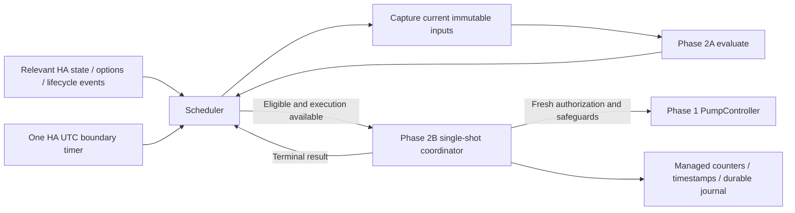

# Native automatic scheduling (Phase 2C)

**Phase 3B update:** [Safety and migration preparation](native-safety-migration.md)
supersedes the earlier open questions below about freshness/quorum, restart
classification, partial-delivery review and pump ownership. Native remains
development-only and normal setup remains inactive.

**Development only, inactive by default. The unchanged Blueprint remains the
only production irrigation executor.** Normal integration setup never constructs,
initializes or starts `_NativeScheduler`, `_ShotCoordinator` or `PumpController`.
No production option, activation service, button, automation or migration path
is added. Only explicit internal HA test-harness calls run this scheduler.

## Separation of responsibilities

`scheduler.py` selects when to evaluate. `irrigation.py` decides whether a shot
is currently eligible. `shot_engine.py` exclusively reserves, executes, supervises
and accounts a shot through `PumpController`. The scheduler never calls pump
services/controller activation, writes counters or timestamps, changes phase flags,
or infers delivered water. Coordinator readiness properties are hints; its full
fresh snapshot, recovery checks and final pre-dispatch validation still apply.

The scheduler consumes the existing P1 active/completion flags; it does not
replicate Blueprint phase management or turn `p1_start_eligible` into flag writes.
A P1 diagnostic start opportunity alone cannot authorize execution when Phase 2A
reports `p1_not_active`. P2/P3 manual modes, drain requirements, thresholds, caps
and limits remain unchanged.

Phase 3A optionally attaches the separately initialized private
[`_NativeCycleController`](native-cycle.md). In that harness the scheduler calls
cycle observation before authorization and after terminal execution; the cycle
controller owns managed flags/reference and the shared reset lock. The scheduler
retains its existing listeners and single timer. A supplied uninitialized cycle
controller is rejected, and stopping latches cycle review. Normal setup still
initializes none of these components. Legacy Phase 2C harnesses without a cycle
controller remain supported for isolated regression tests.

## Event and timer behavior

A filtered HA state-change listener watches configured VWC peers, pump, drain
sensors, sunrise/sunset helpers and legacy flag/counter/timestamp/config helpers.
Assignments are resolved against current data/options for each event. A config
entry update listener handles managed options and data changes. HA start and core
configuration updates trigger fresh diagnostics; HA stop closes the scheduler.
The coordinator emits a terminal-result dispatcher signal for an independently
requested internal shot. The scheduler ignores duplicate notifications for its
own completed operation and already-observed accounting updates.

A zero-delay HA `async_call_later` callback coalesces bursts into one evaluation.
There is at most one pending callback, one evaluation/execution task and one
`async_track_point_in_utc_time` timer. Unrelated state events do not wake it.
There is no scheduler polling loop. Phase 2B's existing active-shot safety
supervision remains separate and unchanged.

`next_evaluation()` selects the earliest future UTC instant among sunrise / next
sunrise, P0-to-P1, P1 window end, P2 cutoff, sunset, soak expiry and the decision's
next eligibility time. Boundaries schedule diagnostics even when a sensor or
safety gate blocks; passing time never overrides a blocking reason. Past boundaries
are discarded. A late callback evaluates the present phase, never replaying missed
P1/P2 opportunities or generating an elapsed-time shot count.

HA local aware windows come from Phase 2A. UTC comparisons and elapsed-UTC soak
arithmetic handle Europe/Berlin spring/fall transitions. Ambiguous/nonexistent
helper or derived wall-clock boundaries retain Phase 2A's `invalid_schedule`
fail-closed policy. An invalid schedule without a known future boundary remains
idle until an input/config/lifecycle event; it does not poll to invent a schedule.
Cancelled timer callbacks carry both lifecycle generation and timer revision guards
so a stale callback cannot erase a replacement timer or start an old generation.

## Execution, failure and recovery

A scheduler request first captures and evaluates current inputs, checks coordinator
readiness, then calls only `async_execute()`. That method captures again and
synchronously reserves before awaiting. Triggers while either scheduler execution
or another coordinator shot is active are discarded, with no dirty flag, queued
shot, accumulated request or backlog. Completion/interruption is followed by a
fresh diagnostic and a new boundary timer; a diagnostic never recursively dispatches
a shot. A successful immediately eligible result can request a separate fresh
evaluation after the task ends (current configured soak minimum is one minute).

Failed, rejected, interrupted or unaccounted attempts latch `retry_blocked` for
this scheduler instance. Later events and timers can update diagnostics, but
cannot retry irrigation. Stop/start does not clear this latch. An external internal
shot's failed/interrupted terminal notification also blocks automatic requests.
There is no retry or recovery-clear API. Coordinator and controller recovery
requirements independently block execution; their durable journals are never
rewritten or cleared by the scheduler.

An active P1 shot reaching field capacity completes its originally approved bounded
duration. The completion diagnostic blocks new P1 shots while capacity is reached.
Independent invalid VWC, unsafe drain, pump faults, configuration drift and shutdown
still interrupt it through Phase 2B. P2/P3 active-shot policies are unchanged.

Initialization claims one harness owner per entry but installs no listeners or
timers and cannot irrigate. Explicit start installs observers and evaluates only
present conditions. Stop removes listeners and cancels pending/timed work before
awaiting execution cancellation; the coordinator drains safe pump-off/accounting
work even under repeated caller cancellation. Close permanently prevents restart
of that instance. Integration unload/reload has a cleanup-only hook before shot
and controller cleanup; no setup path starts a replacement scheduler. HA shutdown
closes it. After HA restart a new scheduler is inactive, and coordinator recovery
never restores an interrupted execution or replays accounting.

## Unresolved activation and migration questions

- How will pump ownership be proven and fenced against the Blueprint, manual
  control and other automations? Native owner registries cannot enforce external
  exclusivity. No user automation is inspected or changed here.
- Phase 3A supplies development-only native phase/reset ownership. Phase 3B must
  define the explicit production migration and ownership transfer; no phase flag
  implies that missed shots should run.
- What explicit reviewed activation, migration, rollback and recovery workflow
  should expose these private components? No production activation is provided.
- What cooldown and attempted-water budget should apply after partial delivery,
  interruption or failure? The conservative instance latch is a development policy,
  not a production irrigation strategy.
- What sensor age/quorum policy, DST ambiguity resolution, transactional accounting,
  history retention and hardware watchdog are needed? Existing Phase 2A/2B
  limitations still apply; see [single-shot architecture](native-shot-engine.md).

## Validation scope

Fetched main `af6a2f8` includes merged PR #71. The unchanged baseline passed
**474 tests** after running `scripts/setup-cloud.sh` with Python **3.13.16**, HA
**2025.12.5** and the documented fixture metadata exception. Scheduler tests reuse
local HA fixtures, real state/service dispatch, native HA timers and simulated
pumps. Civil timer clocks are advanced independently of monotonic pump runtimes.
Coverage includes P1/P2/P3, boundaries and soak, eligibility blocks, event bursts,
concurrency, no backlog, missed windows, restart/recovery, reload/unload/shutdown,
faults, safe cancellation, Europe/Berlin DST and the approved P1 capacity policy.

The complete suite passed **539 tests**, including **65 new scheduler tests**.
Ruff lint/format, Python compilation, Git whitespace checks and the Blueprint
unchanged check passed. Run the validation commands in
[cloud development](cloud-development.md). The draft PR records GitHub Actions results. Simulated
software tests do not establish production safety, delivered volume or external
pump ownership. No production HA instance or physical hardware was accessed.
