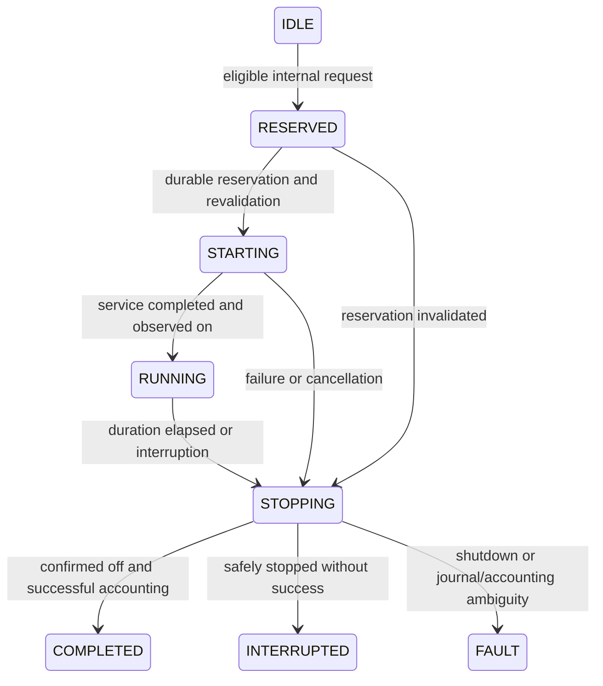

# Native single-shot execution (Phase 2B)

**Development only. The legacy Blueprint remains the active executor.** Normal
integration setup never constructs or initializes `_ShotCoordinator` or
`PumpController`. No activation service, button, automation, scheduler, migration,
catch-up, or production enablement option is added. Existing pump stop services,
entity IDs, configuration keys and user automations remain unchanged.

## Ownership barrier before any future activation

An eligibility decision is not permission to activate hardware. A future native
activation project must establish exclusive ownership of the selected pump:
identify and explicitly relinquish Blueprint and other automation/manual writers,
obtain the user's activation authorization, reconcile the controller's persistent
recovery record, and verify available off/on services and fresh observed off.
This PR does not disable, inspect, or modify user automations. The Phase 1 HA-wide
native controller owner prevents multiple native controllers, but **cannot fence
an unrelated automation**. Do not initialize this internal harness in production.
Only local HA fixtures with simulated pumps invoke it in this phase.

## Coordinator and lifecycle

`shot_engine.py` contains the private `_ShotCoordinator` harness API. Construction
has no effects. Explicit initialization requires an already initialized IDLE
controller for the exact same HA instance and entry. It installs recovery/shutdown
handling, never activates a pump. Production setup has no call to this API.

An explicit `async_execute(operation_id)` captures fresh immutable Phase 2A
`Inputs` and a structured `Decision`, rejects unsafe decisions, and reserves on
HA's event loop without an intervening await. Requests during execution or reset
are rejected instead of queued. UUID operation IDs are generated if omitted;
caller-provided IDs survive in the journal and cannot be reused even after restart.
The selected phase, pump, duration, cycle sunrise ISO ID, all resolved config
values, VWC readings, and initial counter are snapshotted before activation.

The lifecycle is:

Terminal results are retained separately by operation ID. A later internal request
may reserve another shot only if all gates pass and recovery is clear; there is
no automatic retry. Repeated completion calls return the original result and do
not increment again. A controller recovery fault, coordinator recovery fault,
shutdown, or pending execution blocks new requests.

Only `PumpController.async_activate/async_stop/async_close` switch pumps. Private
reservation arguments bind the expected entity and operation ID. A synchronous
revalidation callback runs **after the controller's recovery write, immediately
before dispatching on**. Configuration drift cannot silently select another pump.
Shutdown always uses the controller's retained recovery target, never a newly
configured entity. The Phase 1 observed-off freshness, service timeout, pending
service reconciliation and durable recovery-clear rules are unchanged.

Duration uses monotonic elapsed time from the activation request, including
controller persistence and service latency; a delayed successful on does not get
another full duration. The controller retains its independent hard runtime limit.
The coordinator adds supervision with a one-monitor-interval deadline margin
(10 ms) to avoid racing ordinary nominal completion; STOPPING allows the existing
bounded off service/confirmation work to finish. An overrun is interrupted, never
counted. Observed on and verified off confirm software execution, **not delivered
water volume**.

## Start gates versus active safety policy

Every Phase 2A eligibility gate applies at reservation and final pre-dispatch
revalidation. An active shot uses a separate policy; it does not rerun eligibility
and treat every blocking reason as an emergency.

| Condition | New shot | Active shot |
| --- | --- | --- |
| Pump unavailable/unknown/missing | Block | Interrupt; stop original target |
| Pump reassigned | Re-evaluate selected pump | Interrupt; never switch replacement |
| Configured required drain wet, unavailable or unrecognized | Block | Interrupt, including transient unsafe reports |
| VWC corrupt, out of range, non-finite, or all readings missing | Block | Interrupt |
| Some VWC peers missing with valid readings remaining | Available-sensor mean | Continue with the same Phase 2A mean policy |
| Critical configuration becomes invalid | Block | Interrupt on Phase 2A `invalid_*` reasons |
| VWC/drain ownership or light schedule changes | Re-evaluate | Interrupt |
| P1 field capacity reached with valid readings | Block | **Continue the bounded shot; prevent the next P1 shot** |
| P2 cap/drop, P3 threshold/enablement, shot limit or soak blocks | Block | Continue while safety data is valid |
| Valid P1 completion/phase flags or sunset/P2 cutoff change phase | Re-evaluate | Finish the reserved phase; start-before-boundary policy |
| Light cycle changes or explicit reset starts | Reset required | Interrupt; no old-cycle completion increment |
| Unload/reload, HA stop, cancellation | Block during close | Interrupt and await verified shutdown |
| Controller fault, unexpected early pump off/stop, runtime overrun | Block | Interrupt/fault; never count success |

**Approved P1 field capacity policy:** reaching or exceeding configured capacity
blocks authorization of a new P1 shot. An active P1 shot finishes its originally
authorized duration, without extension or restart. After confirmed shutdown and
successful accounting, every subsequent request captures current VWC again.
Independent drain, sensor, pump, emergency-stop and runtime safety checks continue
throughout; an interrupted or unconfirmed shot is never counted as successful.
This approval applies specifically to P1 and does not change P2 or P3 behavior. Phase 2A's earlier
wording about “active shots stop at field capacity” referred to eligibility for
additional shots in active P1; that module never supervised running hardware.

State-change callbacks latch unsafe pump/drain/VWC reports, so a wet-then-clear
tray report cannot disappear before supervision runs. The supervisor also polls
at 10 ms to detect options changes and controller faults that produce no HA state
event. This is cooperative event-loop supervision, not a hard real-time guarantee;
a stalled HA loop can delay both it and the Phase 1 controller timer. A hardware
failsafe remains a separate future requirement. Phase selection may change during
a shot, but the reserved phase determines accounting.

## Durable accounting and recovery

The version-1 HA Store `growassistant_crop_steering.shot_journal.<entry_id>` retains
operation records. Successful, interrupted and failed records have separate terminal
states, reasons and timestamps. Interrupted/failed shots do not increment success
counters or set managed `last_shot`/`last_shot_type`. There is no replay of either
execution or accounting. No legacy counter increment or last-shot mirror service
is issued by the native harness; it writes existing integration-managed options
and sends their existing entity update signals. Legacy helpers remain Blueprint
owned. Migration/mirroring is a future activation question.

For successful elapsed execution with verified shutdown, final accounting holds
an entry-specific lock shared with cycle reset:

1. Check generation, cycle, safety and the original phase counter.
2. Persist accounting intent before changing managed values.
3. Recheck safety/cycle/cancellation after that persistence await.
4. In one synchronous options update, increment the reserved phase's managed
   `*_shots_done` and set `last_shot` plus `last_shot_type` at confirmed completion.
5. Persist the terminal result and its last-accounting checkpoint.

Reset invalidates the generation immediately, then waits for the accounting lock
before applying existing helper resets. A completion that resumes after reset
cannot overwrite counters from the new cycle. Reservations across a light-cycle
change require reset. Restarts with an old-cycle accounting checkpoint and nonzero
counters block for review rather than assuming those counters were reset.

Cancellation/reset arriving during final journal persistence changes the result
to interrupted and compensates only the managed values this operation wrote, if
they still equal its expected values. External changes are preserved and cause a
recovery fault. A completed operation cannot be retroactively cancelled after its
completion has returned. Shutdown hooks block new requests immediately and drain
the independent execution task before closing the controller; caller cancellation
is shielded until shutdown/accounting safety work finishes.

**Atomicity limitation:** HA config-entry options use delayed persistence, and
Store is an independent file. There is no transaction spanning them. Power loss
may leave a reservation, a pending accounting intent, or a final journal with old
options. Startup converts nonterminal/pending records to interrupted requiring
manual review, never increments/replays them, and checks the most recent committed
managed values against restored options in the same cycle. A disagreement blocks
execution. Unresolved/failed storage writes stay blocked; a late snapshot cannot
overwrite a newer journal write. Recovery may undercount confirmed delivery;
avoiding double counts and automatic irrigation takes precedence. If another
writer changed values during compensation, an ambiguous existing count may remain
and requires review. Exactly-once atomic accounting is not claimed.

There is deliberately no production “clear recovery” service. Review the retained
journal, controller recovery and managed options in the development environment
before any manual repair. Do not clear a recovery record merely to resume shots.
Operation records are not pruned: replay protection survives every retained ID.

## Unresolved design questions before production

- How will native ownership be proven and maintained against Blueprint, manual
  controls and other writers? This PR cannot enforce that external barrier.
- Should valid sunset, phase cutoffs or P3 disablement stop an active shot?
  The current explicit policy is above. P1 field capacity behavior is approved
  and is not an unresolved question.
- What cooldown and total water budget should apply to partial/interrupted shots?
  No automatic retry or partial-delivery inference exists; success counters alone
  are not a total attempted-water budget.
- What sensor age limit, quorum and per-sensor policy should replace the existing
  available-sensor mean? Current capture uses latest HA state without an age limit.
- How should DST ambiguous/nonexistent helper times be resolved? Phase 2A still
  fails closed; no new DST interpretation is introduced.
- Should legacy helper mirroring be supported after explicit migration, and how
  should a reset of the same cycle update checkpoint ownership durably?
- Can a transactional ledger replace options plus Store, and how should ambiguous
  recovery be presented/repaired? Current recovery intentionally blocks for review.
- How should retained operation history be bounded without losing duplicate-ID
  protection? No retention policy is added in this development phase.
- How will hardware watchdogs address HA event-loop stalls and incorrect state
  acknowledgements? Software on/off reports do not establish delivered volume.

## Validation

Fetched main `938f125` includes merged PR #70. `scripts/setup-cloud.sh` installed
Python 3.13.16, HA 2025.12.5 and the documented fixture metadata exception. The
unchanged baseline passed **413 tests** before implementation. New tests use real
HA config entries, state events, services and in-memory Store fixtures with mocked
pumps; fixture monotonic clocks run independently of the fixed cycle wall clock.
No production system or hardware is accessed.

Run the complete test suite, Ruff lint/format checks, compilation and whitespace
checks using the commands in [cloud development](cloud-development.md). The draft
PR records the final total and GitHub Actions results.
